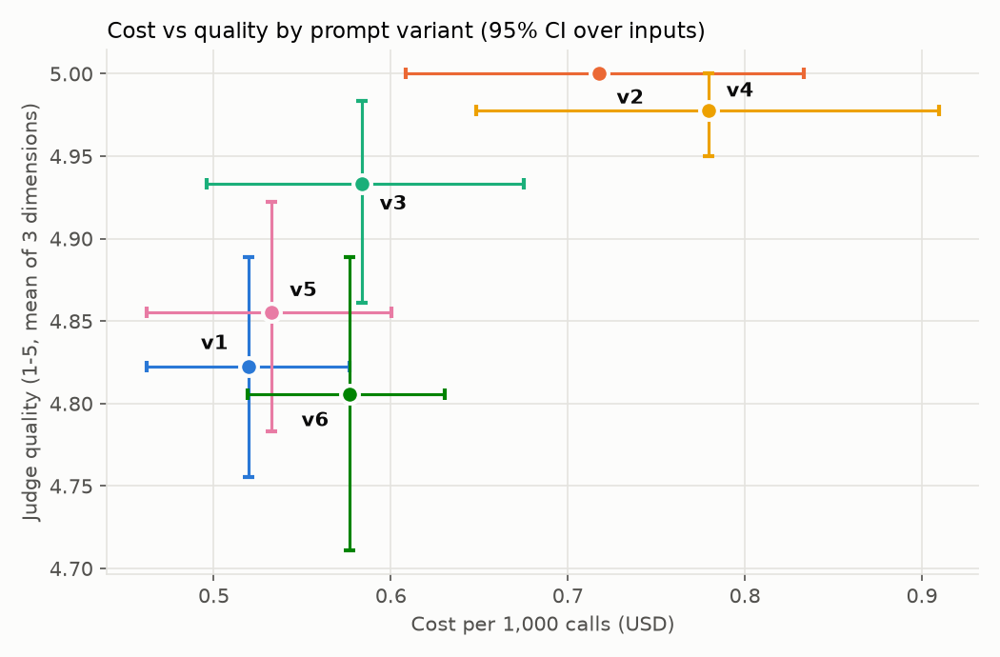
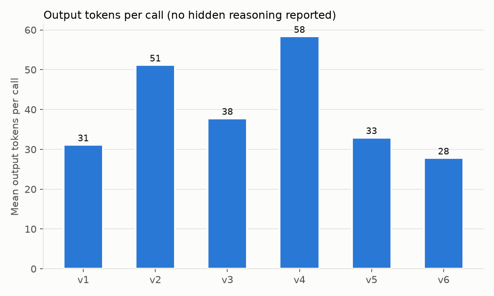

# prompt-eval-harness

A small, reproducible harness for answering one question rigorously:

> **How much does prompt wording change the cost, consistency and quality of an LLM's output, and are those differences real or noise?**

It started as a course exercise (compare four summarization prompts by eye) and grew into a proper experiment after a pilot showed the bare prompt `TL;DR:` costing about 3.7x more tokens than `Summarize the following in one sentence:` on a reasoning model, with roughly half of the extra output being hidden reasoning that word counts never reveal.

## What it does

| Concern | How the harness handles it |
|---|---|
| One input proves nothing | 12 varied input paragraphs (domains, plus a very short and a very long edge case) |
| Model output is non-deterministic | Repeated runs per input and variant (default 5) |
| API latency drifts over time | **Randomised complete block design**: each repetition is a block of every (input, variant) pair in shuffled order |
| Crashes and rate limits | Append-only JSONL, keyed records; re-running resumes and retries failures |
| Word count hides real cost | Captures input, output and **reasoning tokens** from `usage_metadata`; bills reasoning as output |
| "Success" in a trace says nothing about quality | **Blind LLM-as-judge** (faithfulness, coverage, clarity; length deliberately excluded) |
| Can the judge be trusted? | Blind **human audit sample** plus judge/human Spearman correlation |
| Repeated runs are not independent | Unit of analysis is the **input**: average over reps, then bootstrap and permute across inputs |
| Many comparisons inflate false positives | Paired sign-flip permutation tests with **Holm correction** |
| Constraint following | Computed check: does a "one sentence" prompt return exactly one sentence? |
| Observability | Every call traced to LangSmith (optional), tagged `variant:<id>` |
| Reproducibility | `manifest.json` records seed, variants, input hash, deployment, prices, versions (no secrets) |

## Quick start

```bash
python -m venv venv
venv\Scripts\activate            # Windows  (Linux/Mac: source venv/bin/activate)
pip install -r requirements.txt

# 1. Prove the plumbing works offline (mock model, SYNTHETIC numbers, no credentials)
python -m prompt_eval all --dry-run
python -m pytest

# 2. Real run
copy .env.example .env           # then fill it in (Linux/Mac: cp). No key prompts: everything is read from .env
python -m prompt_eval run --limit 5      # cheap smoke test first
python -m prompt_eval run                # full run, resumable
python -m prompt_eval judge
python -m prompt_eval audit              # writes results/run1/human_audit.csv
#   -> open it, fill in human_score (1-5) for ~30 rows, save
python -m prompt_eval analyze            # report.md, tables, figures

# 3. Read the raw outputs (run from the project root)
python compare.py p07                    # one input, all variants, rep 0
python compare.py p07 all                # all variants x all reps, to see run-to-run variation
```

Default size: 12 inputs x 6 variants x 5 reps = **360 summarization calls plus 360 judge calls**. At the assumed prices in `.env.example` that is well under a dollar, but check your own pricing. Runs are sequential on purpose (concurrent calls distort latency), so expect roughly 10-20 minutes per stage. `--workers N` speeds things up if you accept noisier latency numbers.

Set LangSmith variables before the first call (the harness loads `.env` first). Project traces appear under `LANGCHAIN_PROJECT`.

## The variants

| id | prompt prefix | purpose |
|---|---|---|
| v1 | `Summarize the following in one sentence:` | baseline; hard length constraint |
| v2 | `Write a short summary of this paragraph:` | vague length |
| v3 | `Condense this into a concise statement:` | vague length |
| v4 | `TL;DR:` | no instruction at all |
| v5 | `TL;DR in one sentence:` | **hypothesis**: adding a constraint to v4 removes its cost penalty |
| v6 | multi-sentence instruction ("You are a careful editor. Summarize ... at most 25 words ... return only the summary.") | **hypothesis**: a longer, specific prompt buys consistency or quality, but costs more *input* tokens; is the trade worth it? Also checked against its 25-word limit |

## Pilot observations (course notebook, 1 input, 5 reps, not the harness)

These motivated the project; they are *not* results of this harness.

- Mean words per summary: v1 23.4 (sd 0.5), v2 20.8, v3 15.6-15.8, v4 135-147 (sd 47-56). The pattern replicated across two independent 20-call runs.
- Single-call token usage on `gpt-5-mini`: v4 = 534 total (496 output, **256 reasoning**); v1 = 143 total (100 output, 64 reasoning). Even the tightest prompt spent more on hidden reasoning than on the visible answer.
- Latency ordering among v1-v3 flipped between runs, so only the large v4 gap was trustworthy.

## Choosing the model

Set the deployment in `.env` (`AZURE_CHAT_DEPLOYMENT`) and the matching prices (`PRICE_IN_PER_M`, `PRICE_OUT_PER_M`). The report prints the prices it used.

- **Reasoning model (e.g. gpt-5-mini):** reasoning tokens are reported and billed as output, so the token-split chart has a "hidden reasoning" layer.
- **Non-reasoning model (e.g. gpt-4o, $2.50 in / $10.00 out per 1M tokens):** reasoning tokens are 0, the chart shows visible output only, and cost differences come purely from output length and prompt length. Leave `REASONING_EFFORT` unset.
- **Comparing models:** run each into its own folder (`--out results/gpt-4o`, `--out results/gpt-5-mini`), changing only the deployment and prices in `.env`. Prompt effects can differ by model, and that interaction is itself a result worth reporting.
- **Judge spend is tracked separately** (`JUDGE_PRICE_IN_PER_M` / `JUDGE_PRICE_OUT_PER_M`) and the report's "Experiment spend" table shows generation, judging and total. If the judge is a different model and its prices are unset, the report warns you. Spend from failed attempts that a retry later replaced is not counted.
- Estimated spend for the default run (360 generation + 360 judge calls) on gpt-4o is roughly a dollar. Cached-input pricing is not applied because these prompts are far below the caching threshold.
- `analyze` also projects cost at scale (`--monthly-calls`, default 1,000,000), which is where small per-call gaps become visible.

## Results

Run: generator `gpt-4o`, judge `gpt-5-mini`, 12 inputs x 6 variants x 5 reps = 360 generation calls (0 errors) plus 360 judge calls, seed 42. Full tables and CIs are in `results/run1/report.md`. Total spend was **$0.53** ($0.22 generation, $0.31 judging; the judge cost more than the thing it was judging).

| variant | prompt | words | output tokens | cost / 1k calls | vs v1 | one sentence | judge quality (1-5) |
|---|---|---|---|---|---|---|---|
| v1 | Summarize the following in one sentence: | 25.7 | 31 | $0.52 | 1.00x | 100% | 4.82 |
| v2 | Write a short summary of this paragraph: | 42.3 | 51 | $0.72 | 1.38x | 8% | 5.00 |
| v3 | Condense this into a concise statement: | 29.7 | 38 | $0.58 | 1.12x | 87% | 4.93 |
| v4 | TL;DR: | 46.6 | 58 | $0.78 | 1.50x | 2% | 4.98 |
| v5 | TL;DR in one sentence: | 26.2 | 33 | $0.53 | 1.03x | 100% | 4.86 |
| v6 | multi-sentence "careful editor" prompt | 22.3 | 28 | $0.58 | 1.11x | 100% | 4.81 |




**Findings** (differences are paired by input, Holm-adjusted):

1. **A stated length constraint is what controls cost.** Prompts without one (v4 `TL;DR:`, v2) produced about 1.6-1.8x more words and cost 1.5x and 1.4x the baseline (p_holm < 0.01). At 1,000,000 calls per month that is roughly $780 versus $520. Output tokens differ more (1.9x for v4) than cost does (1.5x) because the input tokens are the same.
2. **Adding "in one sentence" removed the TL;DR penalty.** v5 vs v1: +$0.013 per 1k calls, CI [-0.011, 0.041], not significant. v4 vs v1: +$0.26, CI [0.17, 0.35]. v5 was not tested directly against v4; the intervals do not overlap.
3. **The longer, more specific prompt (v6) did not buy quality.** It gave the shortest and tightest output (22.3 words, within-input SD 1.7 vs 3.1, not significant after correction) and no measurable judge-quality change, but cost 11% more than v1 (p_holm = 0.004) because of its extra input tokens. It also exceeded its own 25-word limit in 13% of calls (86.7% compliance).
4. **Vague wording does not constrain length.** "Short summary" returned one sentence 8% of the time, "concise statement" 87%, `TL;DR:` 2%, explicit "one sentence" 100%.
5. **Latency showed no reliable difference.** The only gap was v4 (+0.65 s), not significant after correction. The run was also being rate-limited (2-3 retries per call), so latency is weak evidence here.
6. **The quality scores should not be relied on.** The judge's scores are saturated (4.81-5.00 on a 5-point scale), and it scored the longest outputs (v2, v4) slightly higher than v1 (+0.18 and +0.16). More importantly, **judge vs human agreement was Spearman rho = -0.38** (n = 30, one rater, scores near the ceiling with many ties). The judge is not validated against the human audit, so no quality conclusion is drawn. Cost, token, length and constraint-adherence results are computed directly from the outputs and do not depend on the judge.

**Relation to the pilot.** The pilot (one input, a reasoning model) showed `TL;DR:` costing about 3.7x more tokens. Here the direction replicates across 12 inputs but the effect is smaller (1.5x cost, 1.9x output tokens) on a non-reasoning model with zero hidden reasoning tokens, which is consistent with part of the pilot's gap being reasoning overhead. That interaction was not tested directly.

**What I would test next:** validate the judge before using it (harder inputs with more score spread, a second rater, a reference-based metric); run the same prompts on `gpt-5-mini` into `results/gpt-5-mini` to measure the model-by-prompt interaction; and test `REASONING_EFFORT` as another factor.

## Inspecting individual calls: `compare.py` and LangSmith

The report answers "which variant is better and is the difference real". Two tools answer "what did the model actually write?":

**`compare.py`** reads the harness's own records (`results/run1/runs.jsonl`) and prints one input's source paragraph and the outputs from every variant, with word and token counts. Run it from the project root:

```
python compare.py p07            # all variants, rep 0
python compare.py p07 3          # a different rep
python compare.py p07 all        # all variants x all reps, to see run-to-run variation
```

It is the better tool for targeted comparisons, such as how `TL;DR:` expanded a paragraph that the one-sentence prompts kept short. A single input is an illustration, not evidence: the conclusions in the report rest on all 12 inputs and every rep.

**LangSmith** (optional, set the `LANGCHAIN_*` variables in `.env`) traces every call and tags it `variant:<id>`. It adds what the harness records do not: the exact request, per-call timing and token detail in the trace view, and a place to monitor production traffic. It does not tell you whether an answer was good; tracing is not evaluation, which is why the judge, the human audit and the statistics exist. Tips for reading the project:

- The trace list also holds setup errors from before the full run (wrong deployment name, an unsupported parameter) and rate-limit retries. Set a **time range** that starts at the full run and filter to successful runs.
- Filter by tag (`variant:v4`) to compare one variant, or to find its slowest and most expensive calls.
- For side-by-side reading of outputs, `compare.py` is quicker than opening traces one at a time.

## Human audit rubric

`audit` writes a blind sample (`human_audit.csv`: item id, source paragraph, summary, empty `human_score`). The rater never sees the variant or the judge's score. Give **one overall whole-number score per row, 1-5**, judged against the source paragraph:

| Score | Meaning |
|---|---|
| 5 | Accurate, covers the main point and the key facts, reads cleanly. Nothing to fix. |
| 4 | Accurate and clear, but misses one secondary fact or is slightly awkward. |
| 3 | Accurate but incomplete (misses the main point or several key facts), or complete but poorly worded. |
| 2 | Notable problem: a significant factual slip, distorted emphasis, or most key facts missing. |
| 1 | Wrong or unusable: contradicts the source, invents claims, or is off-topic. |

Rules for edge cases:

- **Faithfulness first.** Anything invented or wrong caps the score at 2, even if the rest is good.
- **Length is not quality.** Do not reward a longer summary for including more or a shorter one for being brief. Rambling or repetition costs a point under clarity.
- **Preamble** ("Here is a summary:") costs at most one point.
- **Format constraints are measured separately** (one-sentence and 25-word checks are computed, not scored by hand), so do not dock quality for them.
- **Use the whole scale.** When two summaries differ in quality, give them different scores. Tie-breakers for near-identical summaries: (1) an omitted fact, (2) an unsupported inference or added emphasis, (3) awkward wording.

These criteria mirror what the LLM judge scores (faithfulness, coverage, clarity), collapsed into a single mark. The report compares the two with a Spearman correlation. If most summaries are good, human scores cluster at 4-5 and the correlation is weak because there is little spread to rank. That is a limit of the audit, not necessarily of the judge, and the report should say so.

## Limitations (read before citing any number)

- Inputs are synthetic and few (12); effects may depend on input type. Use `--inputs your.jsonl` for a real corpus.
- The judge is a model. If it is the same model family as the generator it may favour its own style; set `JUDGE_DEPLOYMENT` to a different model if possible, and check the audit correlation.
- Latency reflects service load at the time of the run; trust only large gaps.
- Costs use assumed list prices; reasoning-token counts from the API may be reported in coarse steps.
- Dry-run output is synthetic and is git-ignored; never present it as a finding.

## Layout

```
prompt_eval/
  data.py      inputs and prompt variants
  llm.py       Azure client (retries, tracing) and offline mock
  runner.py    experiment plan, resumable execution, manifest
  judge.py     blind judge, human-audit sample
  stats.py     bootstrap CI, sign-flip test, Holm, Spearman
  analyze.py   tables, comparisons, report
  plots.py     figures
tests/         23 tests, no credentials needed
compare.py     print one input's outputs across variants and reps (reads results/run1/runs.jsonl)
```

## Ideas for extension

Add a reference-based metric (ROUGE or embedding similarity) to cross-check the judge; compare two models on the same prompts; test `REASONING_EFFORT` as another factor; add a power calculation to choose the number of inputs.
